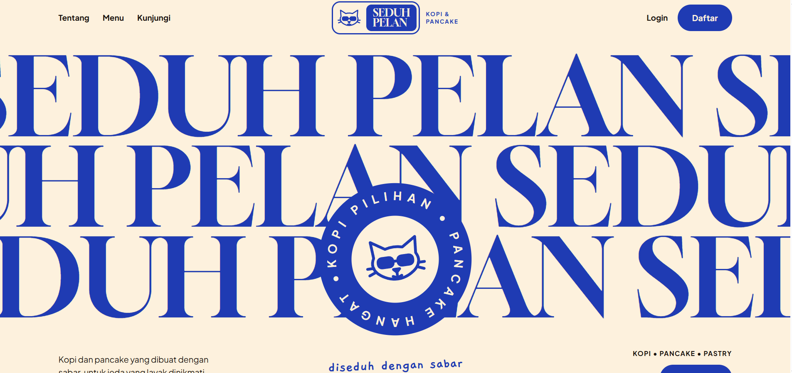
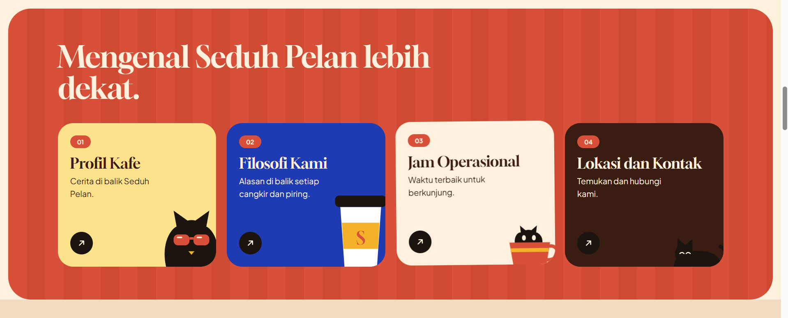
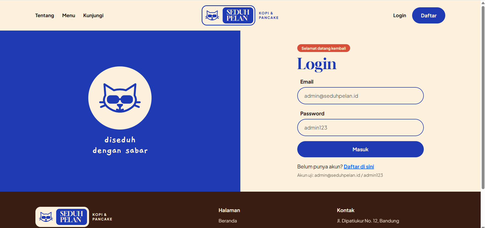
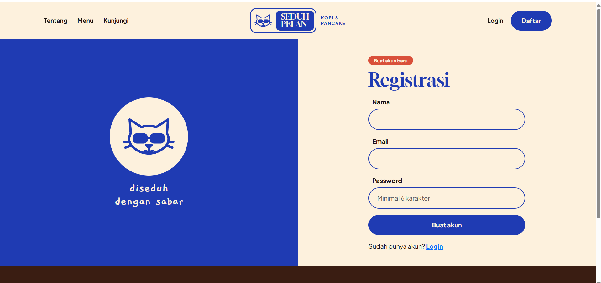
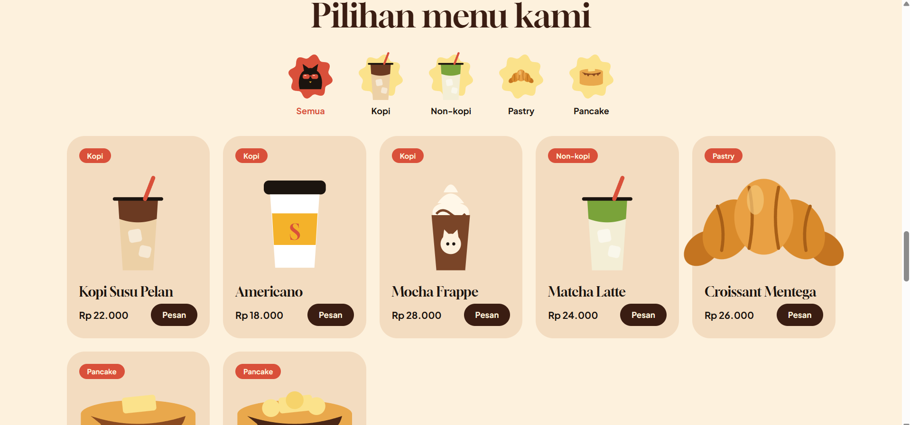

# Seduh Pelan

Website dan REST API untuk kafe Seduh Pelan. Dibuat untuk UTS Pemrograman Web 1.

- Nama: Jelita Rhuslieta
- NPM: 24552011371
- Kelas: TIF RP 24B CID
- Dosen: Nova Agustina, S.T., M.Kom.

## Project 1 (Website)

Buka `index.html` dengan Live Server. Framework CSS: Bootstrap 5.

Halaman: Utama (kumpulan informasi perusahaan), Detail Informasi, Login, Registrasi, dan Menu Utama (setelah login).
Akun uji: `admin@seduhpelan.id` / `admin123`.

### Screenshot







## Project 2 (CRUD API)

```
cd api
npm install
npm start
```

Data dummy sama dengan `js/data.js` (Project 1). Data disimpan di memori, jadi kembali ke awal saat server dimatikan.

| Resource | Endpoint |
|---|---|
| Informasi perusahaan | GET/POST `/api/informasi`, GET/PUT/DELETE `/api/informasi/:id` |
| Menu kafe | GET/POST `/api/menu`, GET/PUT/DELETE `/api/menu/:id` |
| User (login dan registrasi) | GET/POST `/api/users`, GET/PUT/DELETE `/api/users/:id` |

Contoh body `POST /api/users`:

```json
{ "nama": "Budi", "email": "budi@seduhpelan.id", "password": "budi1234" }
```

### Hasil uji Postman


